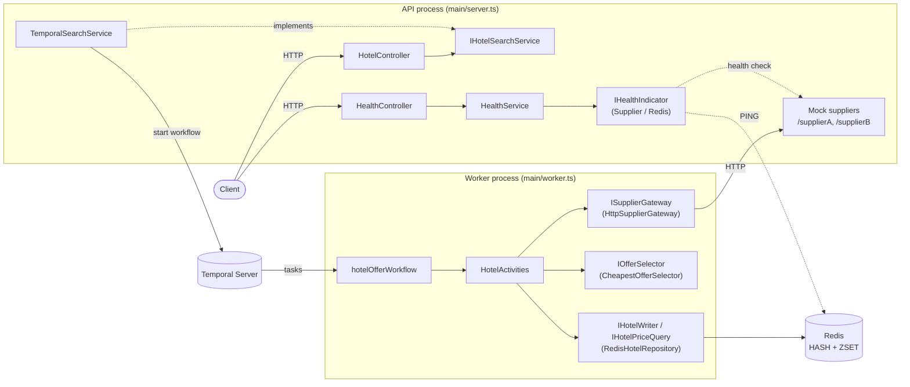
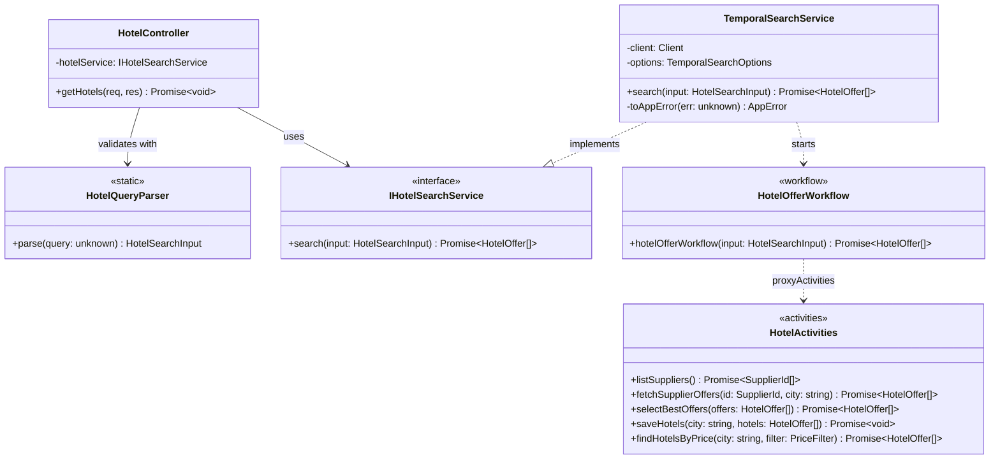
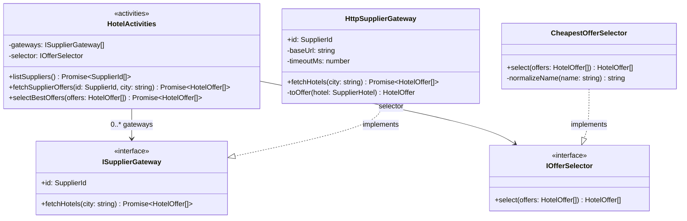
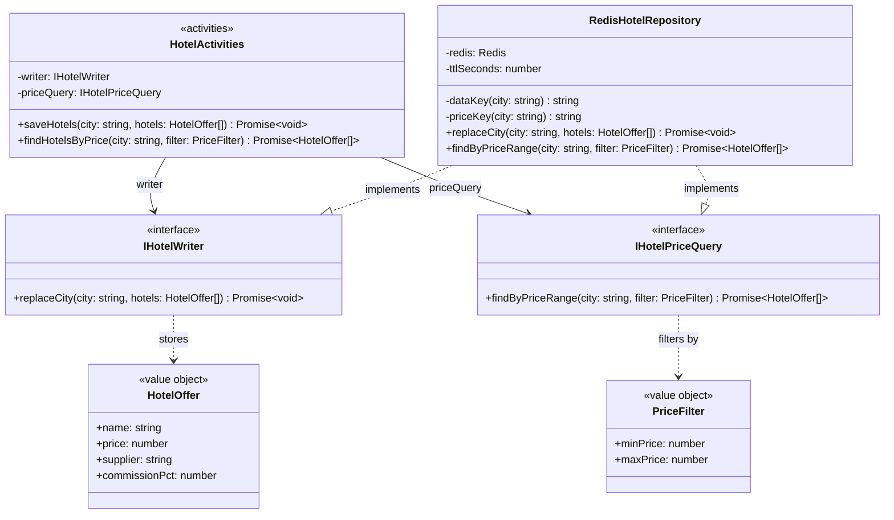
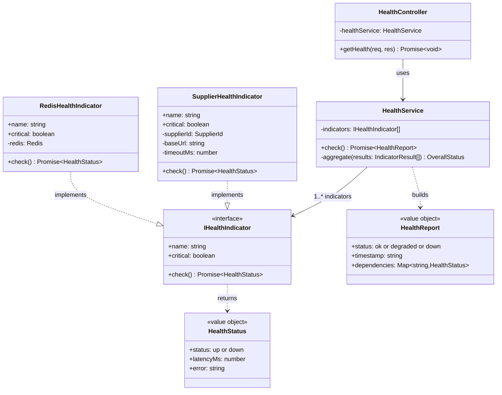
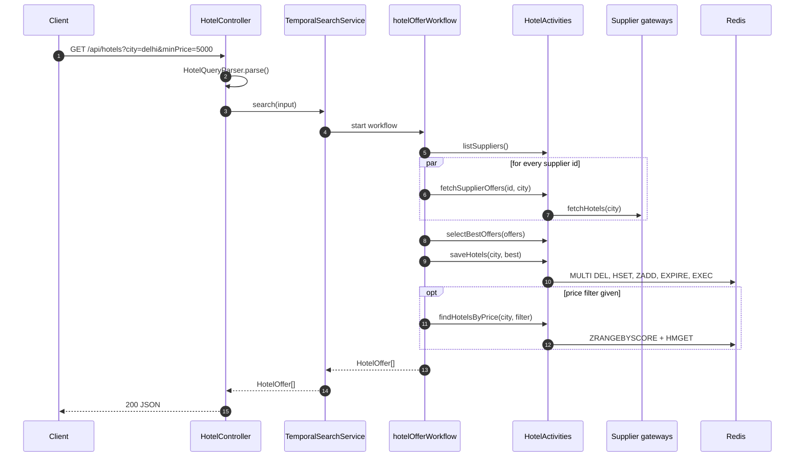

# Hotel Offer Orchestrator: Backend

Collects hotel offers from multiple suppliers, removes duplicate hotels by name, keeps the **cheapest offer per hotel**, stores the result in **Redis**, and filters by price range **inside Redis**. The flow is orchestrated by **Temporal**.

**Stack:** Node.js 20 · TypeScript · Express · Temporal · Redis · Docker Compose

Design: ports-and-adapters (SOLID). Everything is reached through an interface, and concrete classes are created only in `src/main/server.ts` and `src/main/worker.ts`.

---

## 1. Quick start

Run from the repository root:

```bash
docker compose up --build
```

```bash
curl "http://localhost:3000/api/hotels?city=delhi"
curl "http://localhost:3000/api/hotels?city=delhi&minPrice=5000&maxPrice=6000"
curl "http://localhost:3000/health"
```

| Service | Purpose | Port |
|---|---|---|
| `api` | Express API + mock suppliers | 3000 |
| `worker` | Temporal worker (workflow + activities) | n/a |
| `temporal` | Temporal dev server (UI on 8233) | 7233 |
| `redis` | Hotel store and price index | 6379 |


---

## 2. Architecture



Dependencies point inward: `domain` ← `ports` ← `adapters / application / temporal / http` ← `main`.

---

## 3. Class diagrams

### 3.1 Search flow



### 3.2 Suppliers and pricing strategy



### 3.3 Storage and domain models



### 3.4 Health module



---

## 4. SOLID in this project

| Principle | Where |
|---|---|
| **S**ingle responsibility | Controller = HTTP only, parser = validation, gateway = one supplier, selector = pricing rule, repository = Redis layout, health service = aggregation |
| **O**pen / closed | New supplier = new id in `SUPPLIERS`. New pricing rule = new `IOfferSelector`. New health check = new `IHealthIndicator`. No existing class is edited |
| **L**iskov substitution | Every port has a contract (below), so any implementation can replace another |
| **I**nterface segregation | `IHotelWriter` and `IHotelPriceQuery` are separate: saving cannot query and filtering cannot write |
| **D**ependency inversion | Classes depend on interfaces in `src/ports`; `new` is called only in `main/server.ts` and `main/worker.ts` |

**Port contracts**

| Port | Contract |
|---|---|
| `ISupplierGateway` | Returns normalised offers labelled with its own id; throws on failure, never partial data |
| `IOfferSelector` | One offer per hotel name, sorted by price ascending; no I/O |
| `IHotelWriter` | `replaceCity` atomically replaces the city list; empty list clears it |
| `IHotelPriceQuery` | Hotels in `[minPrice, maxPrice]` inclusive, cheapest first; a missing bound is unbounded |
| `IHotelSearchService` | Resolves to the final list, or rejects with an `AppError` carrying an HTTP status |
| `IHealthIndicator` | `check()` never throws; failure is returned as `status: 'down'` |

---

## 5. Request flow



Workflow rules:

1. Suppliers are called **in parallel**. A failing supplier is skipped; if **all** fail, the API returns `502`.
2. The selector keeps the cheapest offer per hotel (a tie goes to the supplier listed first).
3. The result is saved in Redis, and if a price filter was given, **Redis** does the filtering.
4. Each activity has a 10 s timeout and 3 retries with backoff.

---

## 6. Redis data model

| Key | Type | Content |
|---|---|---|
| `hotels:<city>:data` | HASH | `normalizedName → JSON(HotelOffer)` |
| `hotels:<city>:by-price` | ZSET | member = `normalizedName`, score = `price` |

- Price filter: `ZRANGEBYSCORE key <min|-inf> <max|+inf>`, then `HMGET` to load the hotels.
- Writes use one `MULTI/EXEC` transaction, so readers never see a half-written city.
- Keys expire after `CACHE_TTL_SECONDS` (default 300).

---

## 7. API

### `GET /api/hotels?city=<city>[&minPrice=<n>][&maxPrice=<n>]`

- `city` is required (case-insensitive; mock data has `delhi` and `mumbai`).
- `minPrice` and `maxPrice` are optional, non-negative, and `minPrice <= maxPrice`.
- Returns offers sorted by price ascending. An unknown city returns `200 []`.

```json
[
  { "name": "Holtin",  "price": 5340, "supplier": "Supplier B", "commissionPct": 20 },
  { "name": "Radison", "price": 5900, "supplier": "Supplier A", "commissionPct": 13 }
]
```

| Status | Code | Meaning |
|---|---|---|
| 400 | `VALIDATION_ERROR` | invalid query |
| 404 | `NOT_FOUND` | unknown route |
| 502 | `SUPPLIERS_UNAVAILABLE` | every supplier failed |
| 500 | `WORKFLOW_FAILED` / `INTERNAL_ERROR` | unexpected failure |

### `GET /health`

| Overall status | HTTP | Rule |
|---|---|---|
| `ok` | 200 | everything up |
| `degraded` | 200 | some indicator down, service still works |
| `down` | 503 | Redis down, or all suppliers down |

### Mock suppliers

- `GET /supplierA/hotels?city=delhi` and `GET /supplierB/hotels?city=delhi`: static data with overlapping hotels.
- `PUT /supplierA/status` with `{"down": true}`: simulate an outage.

---

## 8. Project structure

```
src/
├── domain/        models, hotel name normalisation
├── ports/         interfaces (ISupplierGateway, IOfferSelector, IHotelWriter,
│                  IHotelPriceQuery, IHotelSearchService, IHealthIndicator)
├── adapters/      suppliers, pricing, redis, health implementations
├── application/   TemporalSearchService, HealthService
├── temporal/      workflows, activities, client
├── http/          controllers, middleware, app
├── mocks/         mock supplier data and router
├── config/        environment config
├── utils/         logger, AppError, retry
└── main/          server.ts, worker.ts (composition roots)
tests/             unit tests using fakes for every port
```

---

## 9. Configuration

| Variable | Default | Description |
|---|---|---|
| `PORT` | `3000` | API port |
| `REDIS_URL` | `redis://localhost:6379` | Redis connection |
| `CACHE_TTL_SECONDS` | `300` | expiry of stored city lists |
| `TEMPORAL_ADDRESS` | `localhost:7233` | Temporal frontend |
| `TEMPORAL_TASK_QUEUE` | `hotel-offers` | shared by API and worker |
| `SUPPLIERS` | `A,B` | supplier ids |
| `SUPPLIER_BASE_URL` | `http://localhost:3000` | supplier API location (`http://api:3000` in Docker) |
| `SUPPLIER_TIMEOUT_MS` | `3000` | per-request timeout |
| `SUPPLIER_<ID>_DOWN` | `false` | start a mock supplier down |

---

## 10. How to extend

- **New supplier:** set `SUPPLIERS=A,B,C` and add a `C` dataset in `src/mocks/supplierData.ts`.
- **New pricing rule:** create a class implementing `IOfferSelector` and pass it in `worker.ts`.
- **New health check:** create a class implementing `IHealthIndicator` (never throw) and add it in `server.ts`.
- **Different store:** implement `IHotelWriter` and `IHotelPriceQuery`, then pass it in `worker.ts`.
- **Different orchestrator:** implement `IHotelSearchService` and pass it to `HotelController`.

---

## 11. Key trade-offs

- A fresh workflow runs per request, so offers are always current. Add a cache check in front of the workflow to cut supplier traffic.
- Hotels are matched by name, ignoring case and extra spaces. Different spellings are not merged.
- No DI container: constructor injection in two composition roots is enough.
- The Temporal dev server in `docker-compose.yml` is for development only.