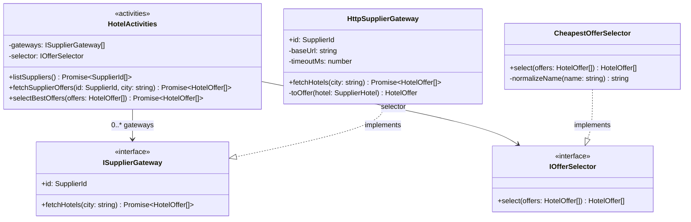
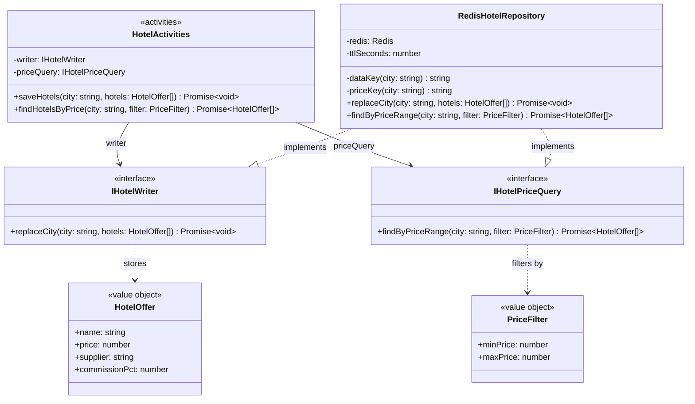
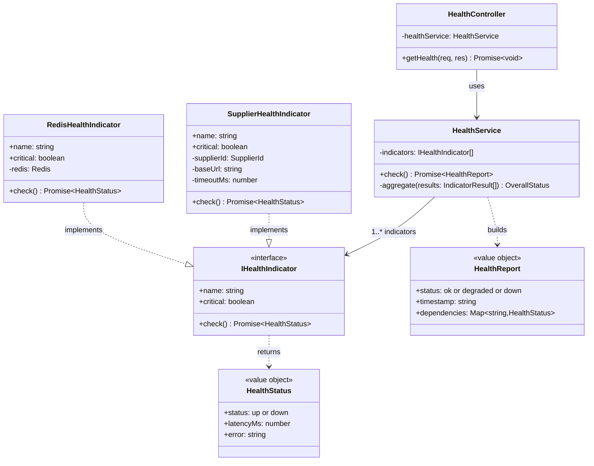
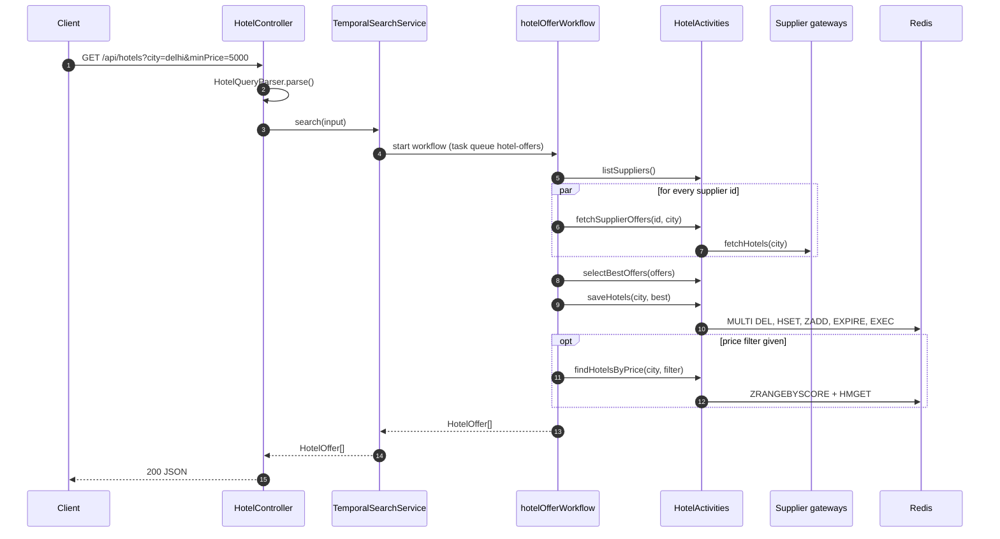

# Hotel Offer Orchestrator: Backend

> This is the backend half of the repository. See the [root README](../README.md) for the full-stack quick start and [`../frontend`](../frontend/README.md) for the UI.

Aggregates overlapping hotel offers from multiple suppliers, de-duplicates hotels by name, keeps the **cheapest offer per hotel**, stores the result in **Redis**, and supports **price-range filtering inside Redis**. The comparison flow is orchestrated by **Temporal**.

Built with a **SOLID, ports-and-adapters design**: every collaborator is reached through an interface, concrete classes are created in exactly two places (the composition roots), and new suppliers, pricing rules or health checks are added by writing a new class, not by editing existing ones.

**Stack:** Node.js 20 · TypeScript · Express · Temporal · Redis · Docker Compose

---

## Table of contents

1. [Quick start](#1-quick-start)
2. [Architecture](#2-architecture)
3. [Class diagrams (LLD)](#3-class-diagrams-lld)
4. [SOLID principles in this project](#4-solid-principles-in-this-project)
5. [Request flow](#5-request-flow)
6. [Redis data model](#6-redis-data-model)
7. [API reference](#7-api-reference)
8. [Project structure](#8-project-structure)
9. [Configuration](#9-configuration)
10. [Running locally](#10-running-locally)
11. [Testing](#11-testing)
12. [Postman collection](#12-postman-collection)
13. [How to extend](#13-how-to-extend)
14. [Design decisions & trade-offs](#14-design-decisions--trade-offs)
15. [Troubleshooting](#15-troubleshooting)

---

## 1. Quick start

Run from the **repository root** (the compose file lives there):

```bash
docker compose up --build
```

This starts Redis, a Temporal dev server, the API (`:3000`), the Temporal worker and the frontend (`:8080`). Temporal Web UI: http://localhost:8233

```bash
curl "http://localhost:3000/api/hotels?city=delhi"
curl "http://localhost:3000/api/hotels?city=delhi&minPrice=5000&maxPrice=6000"
curl "http://localhost:3000/health"
```

Stop with `docker compose down`.

| Service | Purpose | Port |
|---|---|---|
| `api` | Express API + mock suppliers (`node dist/main/server.js`) | 3000 |
| `worker` | Temporal worker running the workflow and activities (`node dist/main/worker.js`) | n/a |
| `temporal` | Temporal dev server (`temporal server start-dev`) | 7233 (gRPC), 8233 (UI) |
| `redis` | Hotel store and price index | 6379 |

Both `api` and `worker` are built from the same image (see `backend/Dockerfile`), only the start command differs.

---

## 2. Architecture

```
                         ┌──────────────────────────────  API process (main/server.ts)  ──────────────────────────────┐
 Client ── HTTP ──►      │ HotelController ─► IHotelSearchService ◄─ TemporalSearchService ──start workflow──┐        │
                         │ HealthController ─► HealthService ─► IHealthIndicator[]                             │        │
                         │ Mock suppliers: /supplierA, /supplierB                                              │        │
                         └─────────────────────────────────────────────────────────────────────────────────────┼────────┘
                                                                                                               ▼
                                                                                                   Temporal Server
                                                                                                               │ tasks
                         ┌──────────────────────────────  Worker process (main/worker.ts)  ───────────────────┼────────┐
                         │ hotelOfferWorkflow ─► HotelActivities                                              ▼        │
                         │     ├─ ISupplierGateway[]  ◄─ HttpSupplierGateway (one per supplier) ──► supplier APIs      │
                         │     ├─ IOfferSelector      ◄─ CheapestOfferSelector                                          │
                         │     ├─ IHotelWriter        ◄─┐                                                              │
                         │     └─ IHotelPriceQuery    ◄─┴─ RedisHotelRepository ──► Redis (HASH + ZSET)                │
                         └─────────────────────────────────────────────────────────────────────────────────────────────┘
```

Layers (dependencies only point **inward**, towards `domain` and `ports`):

| Layer | Folder | Knows about |
|---|---|---|
| Domain | `src/domain` | nothing (plain types, `normalizeHotelName`) |
| Ports | `src/ports` | domain |
| Adapters | `src/adapters` | ports, domain, external libraries (Redis, fetch) |
| Application | `src/application` | ports, domain |
| Temporal | `src/temporal` | ports, domain (activities); workflow only sees types |
| HTTP | `src/http` | ports, application, domain |
| Composition roots | `src/main` | everything (the only place that calls `new` on adapters) |

---

## 3. Class diagrams (LLD)

### 3.1 Search flow


### 3.2 Suppliers and pricing strategy



### 3.3 Storage and domain models



### 3.4 Health module



> Two small, deliberate additions to the health diagram: `IHealthIndicator.critical` (so Redis being down can fail the whole check without `HealthService` knowing about Redis) and `HealthService.aggregate` receiving each indicator together with its result.

---

## 4. SOLID principles in this project

| Principle | Where | What it buys you |
|---|---|---|
| **S**ingle responsibility | `HotelController` (HTTP only) · `HotelQueryParser` (input validation) · `TemporalSearchService` (start workflow, map errors) · `hotelOfferWorkflow` (step order + degradation policy) · `HotelActivities` (one side effect per method) · `HttpSupplierGateway` (talk to one supplier) · `CheapestOfferSelector` (pricing rule) · `RedisHotelRepository` (storage layout) · `HealthService` (aggregation) | Each class has one reason to change. A change of Redis keys touches one file |
| **O**pen / closed | New supplier = a new id in `SUPPLIERS`. New pricing rule = a new `IOfferSelector`. New health check = a new `IHealthIndicator` | Add behaviour by adding classes; `HotelActivities`, the workflow and `HealthService` stay untouched |
| **L**iskov substitution | Every port documents a contract (see below) and tests exercise it | Any implementation can replace another without breaking callers |
| **I**nterface segregation | `IHotelWriter` and `IHotelPriceQuery` are separate; the save activity cannot query and the filter activity cannot write | Smaller fakes, no accidental coupling |
| **D**ependency inversion | Controllers, services and activities depend on interfaces in `src/ports`. Concrete classes are created only in `src/main/server.ts` and `src/main/worker.ts` | Temporal, Redis and HTTP are replaceable details; every class is unit-testable with fakes |

### Port contracts (Liskov)

| Port | Contract every implementation must honour |
|---|---|
| `ISupplierGateway` | Returns normalised `HotelOffer[]` labelled with its own id (`Supplier A`); **throws** if the supplier fails or returns an invalid payload, never partial data |
| `IOfferSelector` | Returns at most one offer per hotel name, sorted by price ascending; pure (no I/O) |
| `IHotelWriter` | `replaceCity` atomically replaces the city's stored list; an empty list clears it |
| `IHotelPriceQuery` | Returns hotels in `[minPrice, maxPrice]` inclusive, cheapest first; a missing bound is unbounded |
| `IHotelSearchService` | Resolves to the final list, or rejects with an `AppError` carrying an HTTP status |
| `IHealthIndicator` | `check()` **never throws**; failures are returned as `status: 'down'` |

### Composition roots (the only places that use `new` on adapters)

```ts
// src/main/worker.ts
const repository = new RedisHotelRepository(redis, config.cacheTtlSeconds);
const activities = new HotelActivities({
  gateways: config.suppliers.ids.map((id) => new HttpSupplierGateway(id, baseUrl, timeoutMs)),
  selector: new CheapestOfferSelector(),
  writer: repository,      // as IHotelWriter
  priceQuery: repository,  // as IHotelPriceQuery
});

// src/main/server.ts
const searchService = new TemporalSearchService(temporalClient, { taskQueue, timeout });
const healthService = new HealthService([
  ...config.suppliers.ids.map((id) => new SupplierHealthIndicator(id, baseUrl, timeoutMs)),
  new RedisHealthIndicator(redis),
]);
```

---

## 5. Request flow



Workflow rules (`src/temporal/workflows.ts`):

1. Ask `listSuppliers()` which suppliers are configured (the workflow has no hardcoded supplier list).
2. Call all suppliers **in parallel** with `Promise.allSettled`. A failing supplier is logged and skipped; if **all** fail, the workflow throws a non-retryable `ALL_SUPPLIERS_UNAVAILABLE` and the API answers `502`.
3. `selectBestOffers` applies the configured `IOfferSelector` (cheapest per hotel; tie goes to the supplier listed first).
4. `saveHotels` stores the de-duplicated list in Redis.
5. If `minPrice` / `maxPrice` were passed, `findHotelsByPrice` lets **Redis** do the filtering.

Each activity has a 10 s timeout and retries up to 3 times with exponential backoff.

> Why is de-duplication an *activity*? A Temporal workflow must be deterministic and cannot receive injected objects. Putting `IOfferSelector` behind an activity keeps the strategy injectable.

---

## 6. Redis data model

Per city:

| Key | Type | Content |
|---|---|---|
| `hotels:<city>:data` | HASH | `normalizedName → JSON(HotelOffer)` |
| `hotels:<city>:by-price` | ZSET | member = `normalizedName`, score = `price` |

- Price filtering uses `ZRANGEBYSCORE key <min|-inf> <max|+inf>`, then `HMGET` hydrates the matching hotels.
- Writes happen in one `MULTI/EXEC` transaction (delete old, write new, set TTL), so readers never see a half-written city.
- Keys expire after `CACHE_TTL_SECONDS` (default 300).

Inspect it:

```bash
docker compose exec redis redis-cli ZRANGE hotels:delhi:by-price 0 -1 WITHSCORES
docker compose exec redis redis-cli HGETALL hotels:delhi:data
```

---

## 7. API reference

### `GET /api/hotels?city=<city>[&minPrice=<n>][&maxPrice=<n>]`

| Param | Required | Notes |
|---|---|---|
| `city` | yes | case-insensitive; the mock data covers `delhi` and `mumbai` |
| `minPrice`, `maxPrice` | no | non-negative numbers, either or both; `minPrice <= maxPrice` |

```json
[
  { "name": "Holtin",  "price": 5340, "supplier": "Supplier B", "commissionPct": 20 },
  { "name": "Radison", "price": 5900, "supplier": "Supplier A", "commissionPct": 13 }
]
```

Sorted by price ascending. An unknown city returns `200 []`.

| Status | Code | Meaning |
|---|---|---|
| 400 | `VALIDATION_ERROR` | invalid query (details per field in `error.details`) |
| 404 | `NOT_FOUND` | unknown route |
| 502 | `SUPPLIERS_UNAVAILABLE` | every supplier failed |
| 500 | `WORKFLOW_FAILED` / `INTERNAL_ERROR` | unexpected failure |

Error body: `{ "error": { "code": "...", "message": "...", "details": ... } }`

### Mock suppliers

| Endpoint | Description |
|---|---|
| `GET /supplierA/hotels?city=delhi`, `GET /supplierB/hotels?city=delhi` | Static data with overlapping hotel names |
| `GET /supplierA/health`, `GET /supplierB/health` | Liveness used by the health indicators |
| `PUT /supplierA/status`, `PUT /supplierB/status` with `{"down": true}` | Simulate an outage at runtime (or start down with `SUPPLIER_A_DOWN=true`) |

### `GET /health`

```json
{
  "status": "ok",
  "timestamp": "2026-01-01T10:00:00.000Z",
  "dependencies": {
    "supplierA": { "status": "up", "latencyMs": 12 },
    "supplierB": { "status": "up", "latencyMs": 9 },
    "redis":     { "status": "up", "latencyMs": 1 }
  }
}
```

| Overall status | HTTP | Rule |
|---|---|---|
| `ok` | 200 | everything up |
| `degraded` | 200 | at least one indicator is down, but the service can still answer |
| `down` | 503 | a critical indicator (Redis) is down, or all non-critical ones (all suppliers) are down |

---

## 8. Project structure

```
src/
├── domain/                 models.ts, hotelName.ts            pure types and helpers
├── ports/                  ISupplierGateway, IOfferSelector, IHotelWriter,
│                           IHotelPriceQuery, IHotelSearchService, IHealthIndicator
├── adapters/
│   ├── suppliers/          HttpSupplierGateway
│   ├── pricing/            CheapestOfferSelector
│   ├── redis/              RedisHotelRepository, createRedisClient
│   └── health/             SupplierHealthIndicator, RedisHealthIndicator
├── application/            TemporalSearchService, HealthService
├── temporal/               workflows.ts, HotelActivities.ts, HotelActivityApi.ts,
│                           createTemporalClient.ts, names.ts
├── http/
│   ├── controllers/        HotelController, HealthController, HotelQueryParser
│   ├── middleware/         asyncHandler, notFound + error handler
│   └── app.ts              Express app factory
├── mocks/                  supplierData.ts, createSupplierRouter.ts
├── config/                 environment configuration
├── utils/                  logger (pino), AppError, retry
└── main/                   server.ts, worker.ts   (composition roots)
tests/                      unit tests with fakes for every port
postman/                    Postman collection
Dockerfile · .env.example   (docker-compose.yml is in the repository root)
```

---

## 9. Configuration

Environment variables (see `.env.example`):

| Variable | Default | Description |
|---|---|---|
| `PORT` | `3000` | API port |
| `LOG_LEVEL` | `info` | pino log level (`silent` to mute) |
| `REDIS_URL` | `redis://localhost:6379` | Redis connection |
| `CACHE_TTL_SECONDS` | `300` | expiry of stored city lists |
| `TEMPORAL_ADDRESS` | `localhost:7233` | Temporal frontend |
| `TEMPORAL_NAMESPACE` | `default` | Temporal namespace |
| `TEMPORAL_TASK_QUEUE` | `hotel-offers` | task queue shared by API and worker |
| `SUPPLIERS` | `A,B` | supplier ids; one gateway and one health indicator are created per id |
| `SUPPLIER_BASE_URL` | `http://localhost:3000` | where supplier APIs live (mocks are inside the API; in Docker `http://api:3000`) |
| `SUPPLIER_TIMEOUT_MS` | `3000` | per-request supplier timeout |
| `SUPPLIER_<ID>_DOWN` | `false` | start a mock supplier in the down state |

---

## 10. Running locally

Requires Node 20+, Redis on `localhost:6379` and Temporal on `localhost:7233`
(for example `docker compose up redis temporal` from the repository root).

```bash
cp .env.example .env      # optional, defaults match the local setup
npm install
npm run dev:api           # terminal 1
npm run dev:worker        # terminal 2
```

Production build: `npm run build`, then `npm run start:api` and `npm run start:worker`.

---

## 11. Testing

```bash
npm test          # unit tests (no Redis or Temporal needed)
npm run typecheck
```

| Test file | What it verifies |
|---|---|
| `CheapestOfferSelector.test.ts` | `IOfferSelector` contract: cheapest wins, name normalisation, ties, ordering |
| `HttpSupplierGateway.test.ts` | `ISupplierGateway` contract: mapping, supplier label, HTTP errors, invalid payloads |
| `RedisHotelRepository.test.ts` | `IHotelWriter` + `IHotelPriceQuery` on an in-memory Redis: ranges, open bounds, replace, isolation |
| `HotelActivities.test.ts` | activities use only injected ports (fakes), unknown supplier, registry |
| `HealthService.test.ts` | `ok` / `degraded` / `down` rules, extra indicators, throwing indicator |
| `HotelController.test.ts` | query parsing and controller delegation to `IHotelSearchService` |
| `TemporalSearchService.test.ts` | workflow start parameters and 502/500 error mapping |

Every test uses fakes for its ports, which is the practical payoff of the interface-first design. The workflow itself is exercised end to end with the Postman collection against a running stack.

---

## 12. Postman collection

Import `postman/hotel-offer-orchestrator.postman_collection.json` (variable `baseUrl` = `http://localhost:3000`).

| Folder | Covers |
|---|---|
| Hotels API | delhi with overlaps, price range, only min, only max, city with no results, validation errors, health |
| Mock suppliers | raw supplier A and B responses |
| Supplier outage simulation | run in order: take B down, fallback, degraded health, take A down, 502, restore both |

Requests contain test assertions, so the collection also runs with the Collection Runner or `newman`:

```bash
npx newman run postman/hotel-offer-orchestrator.postman_collection.json
```

---

## 13. How to extend

**Add a supplier (for example C)**
1. Set `SUPPLIERS=A,B,C`.
2. For the mock, add a `C` dataset in `src/mocks/supplierData.ts`.
3. Done. A gateway, a health indicator and the workflow fan-out are created from the id list. No class is edited.

**Change the pricing rule (for example highest commission)**
1. Create `class HighestCommissionSelector implements IOfferSelector`.
2. Pass `new HighestCommissionSelector()` as `selector` in `src/main/worker.ts`.

**Add a health check (for example Temporal)**
1. Create `class TemporalHealthIndicator implements IHealthIndicator` (never throw).
2. Add it to the `indicators` array in `src/main/server.ts`.

**Swap Redis for another store**
1. Implement `IHotelWriter` and `IHotelPriceQuery`.
2. Pass the new repository in `src/main/worker.ts`.

**Replace Temporal with another orchestrator**
1. Implement `IHotelSearchService`.
2. Pass it to `HotelController` in `src/main/server.ts`.

---

## 14. Design decisions & trade-offs

- **A fresh workflow per request.** Offers are always current and Redis is refreshed on every call. If one supplier is down, Redis holds the partial list until the next successful run. Add a cache check in front of the workflow if you need to cut supplier traffic.
- **Redis filtering via a sorted set.** `ZRANGEBYSCORE` makes price filtering a Redis operation with logarithmic lookup, instead of loading and filtering in Node.
- **Names are the dedupe key.** Matching ignores case and extra whitespace (`Lemon Tree` equals `Lemon tree`). Different spellings of the same hotel are not merged.
- **Ties go to the first supplier** in the configured order.
- **No DI container.** Constructor injection in two composition roots is enough and easier to follow.
- **More files, fewer surprises.** The interface layer adds about six small files; in return suppliers, pricing and health checks grow without touching existing classes. For a service that will never grow beyond two fixed suppliers it would be more structure than needed.
- **The Temporal dev server in `docker-compose.yml` is for development.** Use a persistent Temporal deployment in production.

---

## 15. Troubleshooting

| Symptom | Likely cause / fix |
|---|---|
| API logs `Waiting for Temporal...` | Temporal is still starting; it retries for about a minute |
| `/api/hotels` returns 500 `WORKFLOW_FAILED` | the worker is not running or uses a different `TEMPORAL_TASK_QUEUE` |
| `/api/hotels` returns 502 | both suppliers are down; check `/health` and `PUT /supplier<ID>/status` |
| `/health` returns 503 | Redis is unreachable, or all suppliers are down |
| Worker cannot reach suppliers | `SUPPLIER_BASE_URL` must point to the API (`http://api:3000` in Docker) |
| Stale results after restarting Redis | keys expire after `CACHE_TTL_SECONDS`; the next search refreshes them |
